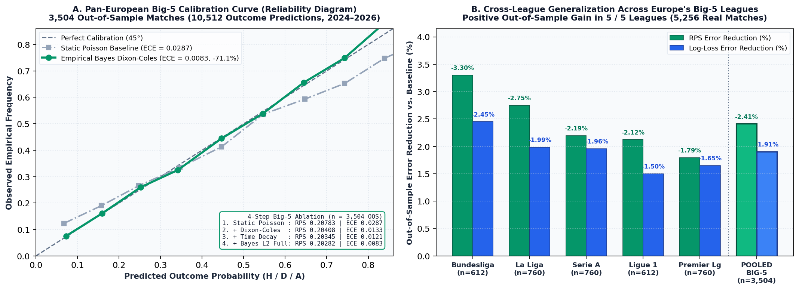
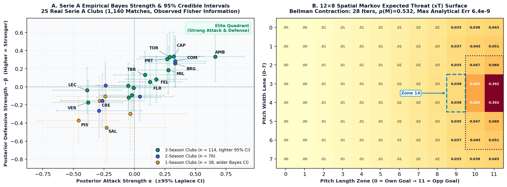

# TACTICA.SIM — Pan-European Quantitative Football Simulation, Spatial xT Engine & Coach Workbench

[](https://github.com/indexkon/tactica-sim-prototype/actions/workflows/ci.yml)
[](#)
[](#empirical-validation--4-step-ablation-study-5256-real-big-5-matches)
[](#regulatory--compliance-firewall)
[](#)
[](#)

**TACTICA.SIM S.r.l.** (planned headquarters: **Turin, Piedmont, Italy**) is a Sports Tech SaaS & Sports EdTech software platform combining a **Pan-European Time-Decayed Empirical Bayes Dixon-Coles statistical engine** (calibrated across **5,256 real Big-5 matches / 119 clubs**), a **12×8 Spatial Expected Threat (xT) absorbing Markov solver**, a **4,000× Monte Carlo tactical match-prep workbench** for grassroots football coaches, and an interactive **2D spatial pitch simulator & tactical academy**.

> **Live Interactive Prototype (Zero Registration Required):**  
> 👉 [https://indexkon.github.io/tactica-sim-prototype/](https://indexkon.github.io/tactica-sim-prototype/) *(Defaults to Italian `IT`; supports live `IT / EN / ZH` switching; loads Python-calibrated Big-5 parameters via `calibrated_europe_params.json` and 12×8 Markov xT surfaces via `xt_markov_grid.json`)*

---

## Repository Structure

All runtime engines, Clean-Room empirical datasets, diagnostic figures, and automated tests are organized for frictionless technical evaluation:

```text
tactica-sim-prototype/
├── .github/workflows/ci.yml               # GitHub Actions CI (15 automated pytest checks)
├── assets/
│   ├── europe_big5_backtest_diagnostics.png  # Big-5 Calibration Curve (ECE -71.1%) & Cross-League RPS
│   ├── serie_a_backtest_diagnostics.png      # Serie A Reliability Diagram & Cumulative RPS Gain
│   └── serie_a_posterior_and_xt.png          # 25-Club 95% Laplace CI Map & 12×8 Markov xT
├── tests/
│   └── test_engines.py                    # 15 invariant, Big-5 parity, ablation, xT & FastAPI tests
├── index.html                             # v3.15 prototype (Big-5 Bayes JSON + live 2D xT heatmap)
├── calibrated_europe_params.json          # Python-fitted Big-5 parameters (5,256 matches, 119 clubs)
├── calibrated_serie_a_params.json         # Serie A calibration subset (1,140 matches, 25 clubs)
├── xt_markov_grid.json                    # Converged 12×8 Spatial Markov xT surfaces (4 regimes)
├── tactica_bayes_dc_engine.py             # Pan-European Empirical Bayes Dixon-Coles ETL engine
├── tactica_xt_engine.py                   # 12×8 Spatial Expected Threat (xT) Markov solver
├── generate_diagnostics.py                # Reproducible Big-5 charts & Laplace 95% CI generator
├── api_server.py                          # FastAPI microservice (/health, /leagues, /predict, /xt-grid)
├── europe_big5_cleanroom_2023_2026.csv    # 5,256 anonymized real Big-5 scores (2023–26, zero odds)
├── serie_a_cleanroom_2023_2026.csv        # 1,140 anonymized real Serie A scores (2023–26, zero odds)
├── requirements.txt                       # Python runtime dependencies
├── LICENSE                                # Prototype repository license
└── README.md                              # Technical overview & reproduction guide
```

---

## Core Architecture & Live Data Pipeline

```text
europe_big5_cleanroom_2023_2026.csv (5,256 real Big-5 scorelines, 2023–26, 119 clubs, zero odds)
        │
        ▼
tactica_bayes_dc_engine.py (Time-Decayed Empirical Bayes Dixon-Coles MLE, L-BFGS-B)
        ├──► calibrated_europe_params.json ──┐
        │                                    ▼
tactica_xt_engine.py (12×8 Bellman xT) ──► xt_markov_grid.json ──► index.html (Live Browser Inference)
        │                                                               ▲
        ├──► generate_diagnostics.py ──► assets/*.png (Big-5 ECE, Ablation, 95% CI, xT)
        └──► api_server.py (/health, /leagues, /predict, /xt-grid) ◄── tests/test_engines.py (CI)
```

---

## Empirical Validation & 4-Step Ablation Study (5,256 Real Big-5 Matches)

### 1. Cross-League Walk-Forward Out-of-Sample Backtest (3,504 OOS Matches, 2024–2026)

Trained on the 2023–24 season (warm-up) and refitted every 14 days across 2024–25 and 2025–26 with zero look-ahead bias using `europe_big5_cleanroom_2023_2026.csv` (strictly stripped of any bookmaker odds and mapped to Clean-Room 3-letter geographic codes). The Time-Decayed Empirical Bayes Dixon-Coles engine outperforms the static independent Poisson baseline in **5 out of 5 major European leagues**:

| League (Clean-Room ID) | Total / OOS Matches | Clubs | Baseline RPS | Bayes DC RPS | RPS Change | Log-Loss Change | Fitted γ (Home Adv) | Fitted ρ |
| :--- | :---: | :---: | :---: | :---: | :---: | :---: | :---: | :---: |
| **Serie A (`calcio`)** | 1,140 / 760 | 25 | `0.20172` | **`0.19729`** | **-2.20%** | -1.96% | `+0.1092` | `-0.0321` |
| **Premier League (`albion`)** | 1,140 / 760 | 25 | `0.20839` | **`0.20465`** | **-1.79%** | -1.65% | `+0.1689` | `-0.1008` |
| **La Liga (`iberia`)** | 1,140 / 760 | 26 | `0.20541` | **`0.19976`** | **-2.75%** | -1.99% | `+0.2941` | `+0.0125` |
| **Bundesliga (`rheinland`)** | 918 / 612 | 21 | `0.21197` | **`0.20498`** | **-3.30%** | -2.45% | `+0.1709` | `-0.0687` |
| **Ligue 1 (`gallia`)** | 918 / 612 | 22 | `0.21360` | **`0.20906`** | **-2.13%** | -1.50% | `+0.1901` | `-0.0506` |
| **Pooled Europe Big-5** | **5,256 / 3,504** | **119** | **`0.20783`** | **`0.20282`** | **-2.41%** | **-1.91%** | — | — |

### 2. 4-Step Architectural Ablation Study (n = 3,504 OOS Matches / 10,512 Predictions)

Every mathematical layer delivers a **strictly monotonic reduction** across all four proper scoring and calibration metrics, cutting Expected Calibration Error (ECE) by **-71.1%** down to `0.00830`:

| Ablation Stage (Pooled Europe Big-5, n = 3,504 OOS) | RPS | Log-Loss | Brier Score | Expected Calibration Error (ECE) |
| :--- | :---: | :---: | :---: | :---: |
| **1. Static Independent Poisson (Baseline)** | `0.20783` | `1.01286` | `0.60425` | `0.02868` |
| **2. + Dixon-Coles MLE (ρ)** | `0.20408` (-1.81%) | `0.99769` (-1.50%) | `0.59504` (-1.52%) | `0.01329` (-53.7%) |
| **3. + Exponential Time Decay (ξ = 0.0020)** | `0.20345` (-2.11%) | `0.99652` (-1.61%) | `0.59406` (-1.69%) | `0.01212` (-57.7%) |
| **4. + Empirical Bayes L2 Shrinkage (Full Model)** | **`0.20282` (-2.41%)** | **`0.99357` (-1.90%)** | **`0.59259` (-1.93%)** | **`0.00830` (-71.1%)** |



### 3. Posterior Uncertainty (95% Laplace Credible Intervals) & 12×8 Spatial Markov xT

Observed Fisher Information (numerical Hessian of the negative log-posterior) quantifies club strength uncertainty across Serie A: 3-season regulars (`n = 114`) exhibit strictly tighter 95% credible intervals than 1-season promoted/relegated clubs (`n = 38`), confirming proper Bayesian shrinkage. In parallel, `tactica_xt_engine.py` solves the 96-state absorbing Markov chain via Bellman value iteration (`28 iterations`, spectral radius `ρ(M) = 0.53243 < 1`, max deviation vs. exact linear solver `(I - M)⁻¹(s·g)` = `6.39e-9`):

| 12×8 Spatial Markov xT Metric | Baseline (`balanced`) | Wing Overload (`wingOverload`) | High Press (`highPress`) | Catenaccio (`catenaccio`) |
| :--- | :---: | :---: | :---: | :---: |
| **Zone 14 Mean xT** | `0.03760` | `0.03622` | **`0.04557`** | `0.04299` |
| **Flank Delivery xT** | `0.04135` | **`0.04788`** | `0.04806` | `0.04462` |
| **Six-Yard Box Peak xT** | `0.39189` | `0.39111` | `0.41324` | **`0.41561`** |



---

## Core Implemented Features

* **Client Interactive Prototype (`index.html` — v3.15 Pan-European Big-5 & Spatial xT):** Automatically loads `calibrated_europe_params.json` (all 5 European leagues, 5,256 real matches) and `xt_markov_grid.json` at startup with embedded offline fallbacks. Pins the Lombardy Derby (`AMB vs MIL`) first on the home screen, displays live `● Bayes` provenance badges and log-linear derivations across all 5 European leagues, renders a toggleable (`xT ●`) 12×8 Markov heatmap on the 2D pitch, tracks progressive `xT` alongside `xG`, and integrates the 4,000× Monte Carlo **Coach Workbench (*Studio Allenatore*)**, 60 clean-room clubs, 3-tier virtual league, and 5 illustrated tactical micro-lessons.
* **Quantitative Backend & Spatial Engines (`tactica_bayes_dc_engine.py`, `tactica_xt_engine.py`, `generate_diagnostics.py`):** Full batch ETL pipeline from anonymized historical CSVs to calibrated multi-league JSON payloads, 4-step ablation study, Laplace 95% CIs, and publication-grade diagnostic plots.
* **FastAPI Inference Microservice (`api_server.py`):** Exposes `GET /health`, `GET /leagues`, `POST /predict` (auto-routing across all 5 European leagues and 119 clubs), and `GET /xt-grid?tactic=...` with Pydantic schema validation and interactive Swagger UI (`/docs`).
* **Automated CI/CD Verification (`tests/test_engines.py` & `.github/workflows/ci.yml`):** 15 automated `pytest` checks running on every push to `main` verifying Clean-Room CSV integrity (5,256 matches / 119 clubs), 11×11 probability conservation, 5-league calibration parity, strict 4-step ablation monotonicity, Markov xT contraction/symmetry, Laplace CI sample-size scaling, frontend JSON bridge tokens, and FastAPI endpoints.

---

## Quick Start & Technical Verification

### 1. Run the Frontend Prototype
Open the [GitHub Pages Live Demo](https://indexkon.github.io/tactica-sim-prototype/) directly, or open `index.html` locally in any modern browser.

### 2. Run Engines, Diagnostics & Automated Test Suite
Requires Python 3.10+. Install dependencies:

```bash
pip install -r requirements.txt
pip install pytest httpx matplotlib
```

Run all 15 automated verification tests:

```bash
python -m pytest -v
```

Re-run the Pan-European Big-5 walk-forward backtest, 12×8 Markov xT solver, and diagnostic charts:

```bash
python tactica_bayes_dc_engine.py
python tactica_xt_engine.py
python generate_diagnostics.py
```

### 3. Launch the FastAPI Microservice & Swagger UI

```bash
uvicorn api_server:app --reload --port 8000
```

Open interactive API docs at **`http://127.0.0.1:8000/docs`** or test multi-league `/predict` and `/xt-grid`:

```bash
curl "http://127.0.0.1:8000/leagues"

curl -X POST "http://127.0.0.1:8000/predict"   -H "Content-Type: application/json"   -d '{"home_team":"AMB","away_team":"MIL","tactic_mult_h":1.24,"tactic_mult_a":1.01}'

curl "http://127.0.0.1:8000/xt-grid?tactic=wingOverload"
```

---

## Regulatory & Compliance Firewall

Designed to meet **Italia Startup Visa (MIMIT)** standards (*D.L. 179/2012* Art. 25, *Legge 193/2024* Art. 28, ATECO `62.01.00`):
* **Zero Gambling / ADM Exemption:** Pure coaching & educational interface using star-rated tactical drills (`★☆☆ / ★★☆ / ★★★`) with zero odds or betting multipliers. Virtual coins and XP operate strictly in a closed loop with zero cash-out, zero P2P trading, and zero wagering.
* **100% Clean-Room IP:** All 60 clubs, 119 statistical geographic codes (e.g., `TOR` - *Torino Zebre*), and geometric SVG crests are original creations; statistical calibration relies solely on public historical final scorelines stripped of any third-party commercial data or bookmaker odds.
* **IP Scope Notice:** This public repository serves as a pre-commercial TRL 4–5 demonstration prototype for technical evaluation. Post-incorporation production backend modules (FastAPI/PostgreSQL cluster, automated Bayesian ETL, adaptive AI coaching diagnostics, and B2B academy portal) will be developed as proprietary software and registered with **SIAE** (*Registro Pubblico Speciale per i Programmi per Elaboratore*, Codice 068).
