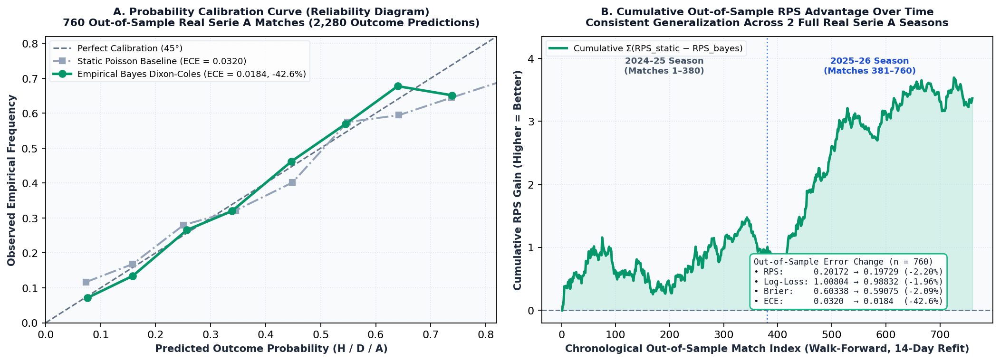

# TACTICA.SIM — Quantitative Football Simulation, Spatial xT Engine & Coach Workbench

[](https://github.com/indexkon/tactica-sim-prototype/actions/workflows/ci.yml)
[](#)
[](#regulatory--compliance-firewall)
[](#)
[](#)

**TACTICA.SIM S.r.l.** (planned headquarters: **Turin, Piedmont, Italy**) is a Sports Tech SaaS & Sports EdTech software platform combining a **Time-Decayed Empirical Bayes Dixon-Coles statistical engine**, a **12×8 Spatial Expected Threat (xT) absorbing Markov solver**, a **4,000× Monte Carlo tactical match-prep workbench** for grassroots football coaches, and an interactive **2D spatial pitch simulator & tactical academy**.

> **Live Interactive Prototype (Zero Registration Required):**  
> 👉 [https://indexkon.github.io/tactica-sim-prototype/](https://indexkon.github.io/tactica-sim-prototype/) *(Defaults to Italian `IT`; supports live `IT / EN / ZH` switching; loads Python-calibrated Serie A parameters via `calibrated_serie_a_params.json` and 12×8 Markov xT surfaces via `xt_markov_grid.json`)*

---

## Repository Structure

All runtime engines, empirical datasets, diagnostic figures, and automated tests are organized cleanly for frictionless technical evaluation:

```text
tactica-sim-prototype/
├── .github/workflows/ci.yml          # GitHub Actions CI (12 automated pytest checks)
├── assets/
│   ├── serie_a_backtest_diagnostics.png  # Reliability Diagram (ECE) & Cumulative RPS Gain
│   └── serie_a_posterior_and_xt.png      # 25-Club 95% Laplace CI Map & 12×8 Markov xT
├── tests/
│   └── test_engines.py               # Math invariants, Bayes parity, xT & FastAPI tests
├── index.html                        # v3.13 prototype (Bayes JSON + live 2D xT heatmap)
├── calibrated_serie_a_params.json    # Python-fitted Bayes parameters (1,140 real Serie A)
├── xt_markov_grid.json               # Converged 12×8 Spatial Markov xT surfaces (4 regimes)
├── tactica_bayes_dc_engine.py        # Time-Decayed Empirical Bayes Dixon-Coles ETL engine
├── tactica_xt_engine.py              # 12×8 Spatial Expected Threat (xT) Markov solver
├── generate_diagnostics.py           # Reproducible calibration charts & Laplace 95% CI script
├── api_server.py                     # FastAPI inference API (/health, /predict, /xt-grid)
├── serie_a_cleanroom_2023_2026.csv   # 1,140 anonymized real Serie A scores (2023–26)
├── requirements.txt                  # Python runtime dependencies
├── LICENSE                           # Prototype repository license
└── README.md                         # Technical overview & reproduction guide
```

---

## Core Architecture & Live Data Pipeline

```text
serie_a_cleanroom_2023_2026.csv (1,140 real Serie A final scorelines, 2023–26)
        │
        ▼
tactica_bayes_dc_engine.py  (Time-Decayed Empirical Bayes Dixon-Coles MLE, L-BFGS-B)
        ├──► calibrated_serie_a_params.json ──┐
        │                                     ▼
tactica_xt_engine.py (12×8 Bellman xT) ──► xt_markov_grid.json ──► index.html (Live Browser Inference)
        │                                                                ▲
        ├──► generate_diagnostics.py ──► assets/*.png (Reliability, Cumulative RPS, 95% CI)
        └──► api_server.py (/health, /predict, /xt-grid) ◄── tests/test_engines.py (GitHub Actions CI)
```

---

## Empirical Validation & Visual Diagnostics (1,140 Real Serie A Matches, 2023–2026)

### 1. Walk-Forward Out-of-Sample Backtest (760 Real Serie A Matches, 2024–2026)

Trained on 2023–24 (380-match warm-up) and refitted every 14 days across 2024–25 and 2025–26 using `serie_a_cleanroom_2023_2026.csv` (1,140 real Serie A final scorelines, 25 clubs, zero bookmaker odds, anonymized to Clean-Room geographic codes):

| Metric (Lower is Better) | Static Independent Poisson (Baseline) | Time-Decayed Empirical Bayes Dixon-Coles | Error Reduction |
| :--- | :---: | :---: | :---: |
| **Ranked Probability Score (RPS)** | `0.20172` | **`0.19729`** | **-2.20%** |
| **Multi-class Log-Loss** | `1.00804` | **`0.98832`** | **-1.96%** |
| **Brier Score** | `0.60338` | **`0.59075`** | **-2.09%** |
| **Expected Calibration Error (ECE)** | `0.03196` | **`0.01836`** | **-42.55%** |

*(Full 3-season fitted parameters: μ = 0.1087, Home Advantage γ = 0.1091 ± 0.0736, Dixon-Coles ρ = -0.0321, ξ = 0.0020, σ²_prior = 0.25. Cumulative out-of-sample RPS gain across 760 matches: +3.3645.)*



### 2. Posterior Uncertainty (95% Laplace Credible Intervals) & 12×8 Spatial Markov xT

Observed Fisher Information (numerical Hessian of the negative log-posterior) quantifies parameter uncertainty across all 25 Serie A clubs: 3-season regulars (`n = 114`, e.g., `AMB`, `TOR`, `MIL`) exhibit tighter 95% credible intervals than 1-season promoted/relegated clubs (`n = 38`, e.g., `PIS`, `CRE`, `VEN`), confirming proper Empirical Bayes shrinkage. In parallel, `tactica_xt_engine.py` solves the 96-state absorbing Markov chain via Bellman value iteration (`28 iterations`, spectral radius `ρ(M) = 0.53243 < 1`, max deviation vs. exact linear solver `(I - M)⁻¹(s·g)` = `6.39e-9`):

| Solver Metric | Baseline (`balanced`) | Wing Overload (`wingOverload`) | High Press (`highPress`) | Catenaccio (`catenaccio`) |
| :--- | :---: | :---: | :---: | :---: |
| **Zone 14 Mean xT** | `0.03760` | `0.03622` | **`0.04557`** | `0.04299` |
| **Flank Delivery xT** | `0.04135` | **`0.04788`** | `0.04806` | `0.04462` |
| **Six-Yard Box Peak xT** | `0.39189` | `0.39111` | `0.41324` | **`0.41561`** |


---

## Core Implemented Features

* **Client Interactive Prototype (`index.html` — v3.13 MIMIT Bayes & xT Spatial):** Automatically loads `calibrated_serie_a_params.json` and `xt_markov_grid.json` at startup (with embedded offline fallbacks), pins the Lombardy Derby (`AMB vs MIL`) first on the home screen, renders a toggleable (`xT ●`) 12×8 spatial Markov threat heatmap on the 2D pitch, tracks progressive `xT` alongside `xG`, and integrates the 4,000× Monte Carlo **Coach Workbench (*Studio Allenatore*)**, 60 clean-room clubs, 3-tier virtual league, and 5 illustrated tactical micro-lessons.
* **Quantitative Backend & Spatial Engines (`tactica_bayes_dc_engine.py`, `tactica_xt_engine.py`, `generate_diagnostics.py`):** Full batch ETL pipeline from anonymized historical CSVs to calibrated JSON payloads, Laplace posterior 95% CIs, and diagnostic plots.
* **FastAPI Inference Microservice (`api_server.py`):** Exposes `GET /health`, `POST /predict`, and `GET /xt-grid?tactic=...` with Pydantic schema validation and interactive Swagger UI (`/docs`).
* **Automated CI/CD Verification (`tests/test_engines.py` & `.github/workflows/ci.yml`):** 12 automated `pytest` checks running on every push to `main` verifying Clean-Room CSV integrity, 11×11 probability conservation, Dixon-Coles correlation direction, Empirical Bayes shrinkage monotonicity, Markov xT contraction/symmetry, Laplace CI sample-size scaling, frontend JSON bridge tokens, and FastAPI endpoint responses.

---

## Quick Start & Technical Verification

### 1. Run the Frontend Prototype
Open the [GitHub Pages Live Demo](https://indexkon.github.io/tactica-sim-prototype/) directly, or open `index.html` locally in any modern browser.

### 2. Run Engines, Diagnostics & Automated Test Suite
Requires Python 3.10+. Install dependencies:

```bash
pip install -r requirements.txt
pip install pytest httpx matplotlib
```

Run all 12 automated verification tests:

```bash
python -m pytest -v
```

Re-run the real Serie A walk-forward backtest, 12×8 Markov xT solver, and diagnostic charts:

```bash
python tactica_bayes_dc_engine.py
python tactica_xt_engine.py
python generate_diagnostics.py
```

### 3. Launch the FastAPI Microservice & Swagger UI

```bash
uvicorn api_server:app --reload --port 8000
```

Open interactive API docs at **`http://127.0.0.1:8000/docs`** or test `/predict` and `/xt-grid`:

```bash
curl -X POST "http://127.0.0.1:8000/predict"   -H "Content-Type: application/json"   -d '{"home_team":"TOR","away_team":"AMB","tactic_mult_h":1.24,"tactic_mult_a":1.01}'

curl "http://127.0.0.1:8000/xt-grid?tactic=wingOverload"
```

---

## Regulatory & Compliance Firewall

Designed to meet **Italia Startup Visa (MIMIT)** standards (*D.L. 179/2012* Art. 25, *Legge 193/2024* Art. 28, ATECO `62.01.00`):
* **Zero Gambling / ADM Exemption:** Pure coaching & educational interface using star-rated tactical drills (`★☆☆ / ★★☆ / ★★★`) with zero odds or betting multipliers. Virtual coins and XP operate strictly in a closed loop with zero cash-out, zero P2P trading, and zero wagering.
* **100% Clean-Room IP:** All 60 clubs, geographic codes (e.g., `TOR` - *Torino Zebre*), and geometric SVG crests are original creations; statistical calibration relies solely on public historical final scorelines stripped of any third-party commercial data or odds.
* **IP Scope Notice:** This public repository serves as a pre-commercial TRL 4–5 demonstration prototype for technical evaluation. Post-incorporation production backend modules (FastAPI/PostgreSQL cluster, automated Bayesian ETL, adaptive AI coaching diagnostics, and B2B academy portal) will be developed as proprietary software and registered with **SIAE** (*Registro Pubblico Speciale per i Programmi per Elaboratore*, Codice 068).
